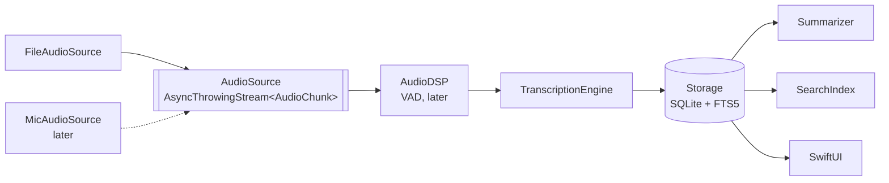

# Lecture Assistant: Design

*Status: draft. Update this before making non-obvious design decisions.*

## Goals
- Transcribe lectures on-device, summarize them, and let the user search and ask
  questions across all lectures, with answers linked to timestamps.
- Nothing leaves the device: no audio, transcripts or queries.
- Demonstrate production engineering (architecture, concurrency, reliability,
  testing, CI) and on-device ML (fine-tuning, distillation, quantization, profiling).

## Non-goals (for now)
- Sharing with other users, TestFlight, cloud sync.
- Downloading from YouTube or any site whose terms prohibit it.
- Speaker diarization.

## Current phase
Personal prototype. Input is **imported MIT OCW lecture files**; microphone
recording comes later through the same `AudioSource` protocol.

## Architecture

| Package | Responsibility | Status |
|---|---|---|
| Shared | `LectureTime`, `AudioChunk`, `TranscriptSegment`, `Lecture` | done |
| AudioCapture | `AudioSource` protocol; `FileAudioSource` | file source done |
| AudioDSP | Resample, VAD, ring buffer (C++) | protocol only |
| Transcription | `TranscriptionEngine`, windowed engine, WhisperKit adapter | WhisperKit `base.en` working |
| Storage | `LectureStore`; SQLite (GRDB 7.11.1) + in-memory | SQLite done; FTS5 in Phase 4 |
| Summarization | `Summarizer` protocol | protocol only |
| Search | `SearchIndex` protocol | protocol only |

The app target only wires packages together and renders state. It depends on
protocols, so tests and previews can use fakes.

## Key decisions

### Timestamps are lecture-relative milliseconds (`LectureTime`)
Every artifact (chunk, segment, summary item, search hit, OCR snapshot) uses the
same clock, so they align without conversion. Chunk start times are derived from
the **sample count**, not wall-clock time, so they don't drift.

### Audio sources are pull-based
`FileAudioSource` uses `AsyncThrowingStream(unfolding:)`: it decodes the next
chunk only when the consumer asks. A slow ASR engine therefore applies natural
backpressure and memory stays bounded. An hour of 16 kHz float audio is ~230 MB,
so buffering the whole file is not acceptable.

The microphone source cannot be pull-based (audio arrives whether or not ASR is
ready). Its policy, to be designed in Phase 2: buffer up to N seconds, then
merge or drop chunks for *live captions only*. Never block capture, and never
drop audio that is being *saved*.

### Real-time pacing for files
`FileAudioSource(pacing: .realTime)` releases each chunk at its end time, which
simulates a live recording. This lets us measure caption latency and test
backpressure without recording real lectures.

### Whisper runs on windows with segment carry-over
`WindowedTranscriptionEngine` buffers 1 s chunks into windows (30 s for batch,
10 s for real-time mode) and calls an `AudioWindowTranscriber` once per window.
If a window yields more than one segment, the last one is probably cut off by
the window edge, so it is dropped and its audio is re-transcribed at the start
of the next window. The engine is independent of WhisperKit
(`WhisperKitTranscription` is a separate target), so the logic is unit-tested
with a scripted fake.

Measured (2026-10-09, M-series Mac, `base.en`, synthetic `say` speech):
5 s windows lost a whole window when it started mid-word (Whisper returned empty
text); 10 s and 30 s windows transcribed every sentence. Hence 10 s is the
real-time minimum. Partial (non-final) captions are the planned way to lower
latency further.

### Storage: SQLite via GRDB, behind `LectureStore`
- Tables `lecture` and `transcriptSegment` (FK with `ON DELETE CASCADE`, index on
  `(lectureId, startMs)`). Times are integer ms, IDs are UUID strings.
- The schema is defined by numbered migrations in `Schema.swift`. Shipped
  migrations are never edited; changes (e.g. the FTS5 table for search) go in a
  new migration so existing lectures survive app updates.
- GRDB row types (`LectureRecord`, `SegmentRecord`) are internal to `Storage`;
  the rest of the app only sees `Shared` models.
- `DatabasePool` (WAL) lets the UI read while transcription writes.
- Segments are written as they arrive, so a crash keeps everything transcribed
  so far. A lecture still marked `transcribing` at launch is marked `interrupted`.
- The same contract tests run against `SQLiteLectureStore` and `InMemoryLectureStore`.

### Imported files are copied into the app container
Files from the picker are security-scoped. We copy them before processing so
access can't expire mid-transcription.

## Concurrency model
- Swift 6 language mode with strict concurrency checking.
- Non-Sendable AVFoundation state (`AVAssetReader`) is confined to an actor.
- UI state is `@MainActor`; pipeline work runs off the main actor.
- Cancelling the consuming task cancels the whole pipeline (`onTermination`).

## Failure modes
| Failure | Current handling | Planned |
|---|---|---|
| File has no audio track | `FileAudioSourceError.noAudioTrack` shown in UI | |
| Decode error mid-file | `readFailed` propagated through the stream | |
| ASR slower than real time | backpressure (file source) | drop/merge policy for mic |
| App killed mid-transcription | segments so far are saved; lecture marked *Interrupted* at next launch | resume from last saved segment |
| Call/Siri interruption, force quit while recording | n/a (no mic yet) | write-ahead journal, 30 s chunks |

## Metric targets
See the project spec; measured values go in [RESULTS.md](RESULTS.md).
