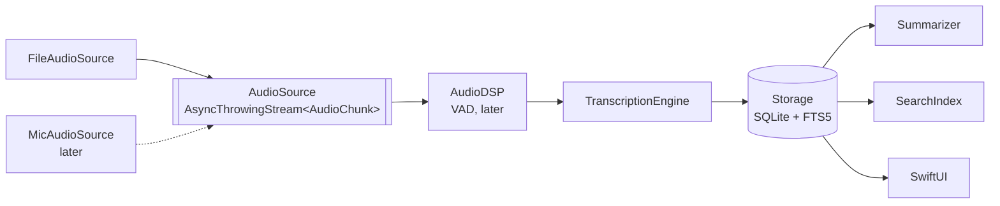

# Lecture Assistant: Design

*Status: draft. Update this before making non-obvious design decisions.*

## Goals
- Transcribe lectures on-device, summarize them, and let the user search and ask
  questions across all lectures, with answers linked to timestamps.
- Nothing leaves the device: no audio, transcripts or queries.
- Demonstrate production engineering (architecture, concurrency, reliability,
  testing, CI) and on-device ML (fine-tuning, distillation, quantization, profiling).

## Non-goals (for now)
- Sharing with other users, TestFlight, cloud sync.
- Downloading from YouTube or any site whose terms prohibit it.
- Speaker diarization.

## Current phase
Personal prototype. Input is **imported MIT OCW lecture files**; microphone
recording comes later through the same `AudioSource` protocol.

## Architecture

| Package | Responsibility | Status |
|---|---|---|
| Shared | `LectureTime`, `AudioChunk`, `TranscriptSegment`, `Lecture` | done |
| AudioCapture | `AudioSource` protocol; `FileAudioSource` | file source done |
| AudioDSP | Resample, VAD, ring buffer (C++) | protocol only |
| Transcription | `TranscriptionEngine`, windowed engine, WhisperKit adapter | WhisperKit `base.en` working |
| Storage | `LectureStore`; SQLite (GRDB 7.11.1) + in-memory; FTS5 keyword search | done |
| Summarization | Map-reduce summarizer + MLX adapter (Qwen3-1.7B 4-bit) | working on Mac; iPhone untested |
| Search | Passages, vector index, hybrid retrieval, grounded answers; MLX embedder | done; answers ~1 in 5 wrong (RESULTS.md) |

The app target only wires packages together and renders state. It depends on
protocols, so tests and previews can use fakes.

## Key decisions

### Timestamps are lecture-relative milliseconds (`LectureTime`)
Every artifact (chunk, segment, summary item, search hit, OCR snapshot) uses the
same clock, so they align without conversion. Chunk start times are derived from
the **sample count**, not wall-clock time, so they don't drift.

### Audio sources are pull-based
`FileAudioSource` uses `AsyncThrowingStream(unfolding:)`: it decodes the next
chunk only when the consumer asks. A slow ASR engine therefore applies natural
backpressure and memory stays bounded. An hour of 16 kHz float audio is ~230 MB,
so buffering the whole file is not acceptable.

The microphone source cannot be pull-based (audio arrives whether or not ASR is
ready). Its policy, to be designed in Phase 2: buffer up to N seconds, then
merge or drop chunks for *live captions only*. Never block capture, and never
drop audio that is being *saved*.

### Real-time pacing for files
`FileAudioSource(pacing: .realTime)` releases each chunk at its end time, which
simulates a live recording. This lets us measure caption latency and test
backpressure without recording real lectures.

### Whisper runs on windows with segment carry-over
`WindowedTranscriptionEngine` buffers 1 s chunks into windows (30 s for batch,
10 s for real-time mode) and calls an `AudioWindowTranscriber` once per window.
If a window yields more than one segment, the last one is probably cut off by
the window edge, so it is dropped and its audio is re-transcribed at the start
of the next window. The engine is independent of WhisperKit
(`WhisperKitTranscription` is a separate target), so the logic is unit-tested
with a scripted fake.

Measured (2026-10-09, M-series Mac, `base.en`, synthetic `say` speech):
5 s windows lost a whole window when it started mid-word (Whisper returned empty
text); 10 s and 30 s windows transcribed every sentence. Hence 10 s is the
real-time minimum. Partial (non-final) captions are the planned way to lower
latency further.

### Storage: SQLite via GRDB, behind `LectureStore`
- Tables `lecture` and `transcriptSegment` (FK with `ON DELETE CASCADE`, index on
  `(lectureId, startMs)`). Times are integer ms, IDs are UUID strings.
- The schema is defined by numbered migrations in `Schema.swift`. Shipped
  migrations are never edited; changes (e.g. the FTS5 table for search) go in a
  new migration so existing lectures survive app updates.
- GRDB row types (`LectureRecord`, `SegmentRecord`) are internal to `Storage`;
  the rest of the app only sees `Shared` models.
- `DatabasePool` (WAL) lets the UI read while transcription writes.
- Segments are written as they arrive, so a crash keeps everything transcribed
  so far. A lecture still marked `transcribing` at launch is marked `interrupted`.
- The same contract tests run against `SQLiteLectureStore` and `InMemoryLectureStore`.

### Summarization: map-reduce with code-selected key points
- A 1-hour transcript (~9k words) is split into ~1,200-word chunks. **Map:** the
  LLM lists 2 timestamped ideas per chunk. **Reduce:** it writes a 3–4 sentence
  overview from all chunk ideas.
- Key points are chosen by code (first point per chunk, evenly spaced), not by
  the model. Measured: when Qwen3-1.7B selected points itself, every point came
  from the first ~40% of the lecture.
- The model sees transcript lines as `[m:ss] text` and answers `[m:ss] idea`.
  Every returned time is snapped to a real segment in its chunk, so links never
  point to a moment that doesn't exist.
- The logic depends on a `TextGenerator` protocol and is tested with a scripted
  fake; `MLXSummarization` is a separate target (same pattern as WhisperKit).
- The LLM loads on first use, not at launch (~1 GB), and runs with greedy
  decoding and Qwen3's thinking mode disabled.
- MLX compiles Metal shaders, so anything that *runs* MLX must be built with
  xcodebuild (needs the Metal toolchain and trusting the package's macros and
  plugin). `swift build`/`swift test` still compile it and run the logic tests.
- Summaries are stored by migration v2 (`summary`, `summaryPoint`), cascading
  from `lecture`.
- The LLM is loaded through `ModelProvider`, shared with Q&A.

### Keyword search: FTS5 inside the lecture database
- Migration v3 adds `transcriptSegment_ft`, an external-content FTS5 table over
  `transcriptSegment.text`. GRDB's triggers keep it in sync (including cascade
  deletes) and the migration rebuilds it, so existing lectures become searchable.
- Porter stemming plus prefix queries: "connection" finds "connected", "eigen"
  finds "eigenvalue". Every query word must appear in the same segment.
- User text goes through `FTS5Pattern`, which quotes each word, so quotes,
  `AND`, `NEAR(` and `*` can't cause syntax errors.
- Results are ranked by bm25 with matches marked via `highlight()`. Very common
  words are ignored when the query has other words, and stopword-only queries
  skip ranking: scoring every match of "the" took 165 ms at 200 hours.
- It lives in `Storage`, not `Search`, because the index is part of the lecture
  database; `Search` is reserved for embedding-based and hybrid search.

### Q&A retrieval: hybrid search over overlapping passages
- The retrieval unit is a ~60 s passage of consecutive segments, starting every
  30 s, so an idea crossing one boundary is whole in a neighbor.
- Semantic search embeds passages with bge-small-en-v1.5 (MLX, 384 dimensions)
  and compares a question against every passage (exact search: 100 hours is
  ~12k vectors, ~18 MB).
- Keyword search reuses FTS5 with any-word matching (a whole question never
  matches every word in one segment). A passage takes its best segment's rank.
- Rankings are fused with Reciprocal Rank Fusion, keyword weighted 0.25: equal
  weights let generic question words pull in wrong passages.
- `Search` has no ML dependencies and is tested with fakes; `MLXSearch` adapts
  MLX. The Hugging Face downloader is shared with summarization via `MLXSupport`.
- All choices were made on dev questions; test questions were run once.

### Q&A answers: grounded, cited, checkable
- The LLM sees the top 5 passages numbered [1]–[5] and must cite them by
  number (timestamps are ambiguous across lectures). Numbers that aren't among
  the given passages are removed, so a link never points to an invented moment.
- It replies NOT_IN_LECTURES (or a recognized decline phrase) when the passages
  don't answer the question.
- The Ask screen always shows the source passages: hand-checking found about
  1 in 5 answers wrong, so users need to be able to verify.
- "Only this lecture" scopes retrieval to one lecture, avoiding cross-subject
  confusion such as "L" (lower-triangular matrix) vs. "l" (quantum number).
- Passages and embeddings are stored by migration v4 with the embedding model's
  name, so vectors from different models never mix. Lectures are indexed when
  transcription finishes, and any missing ones when the Ask screen opens.
- `ModelProvider` loads each model once; summaries and Q&A share the LLM:
  Qwen3-4B on Mac (better answers and summaries, ~2.5× slower), Qwen3-1.7B on
  iPhone until memory there is measured.

### Imported files are copied into the app container
Files from the picker are security-scoped. We copy them before processing so
access can't expire mid-transcription.

## Concurrency model
- Swift 6 language mode with strict concurrency checking.
- Non-Sendable AVFoundation state (`AVAssetReader`) is confined to an actor.
- UI state is `@MainActor`; pipeline work runs off the main actor.
- Cancelling the consuming task cancels the whole pipeline (`onTermination`).

## Failure modes
| Failure | Current handling | Planned |
|---|---|---|
| File has no audio track | `FileAudioSourceError.noAudioTrack` shown in UI | |
| Decode error mid-file | `readFailed` propagated through the stream | |
| ASR slower than real time | backpressure (file source) | drop/merge policy for mic |
| App killed mid-transcription | segments so far are saved; lecture marked *Interrupted* at next launch | resume from last saved segment |
| Call/Siri interruption, force quit while recording | n/a (no mic yet) | write-ahead journal, 30 s chunks |

## Metric targets
See the project spec; measured values go in [RESULTS.md](RESULTS.md).
